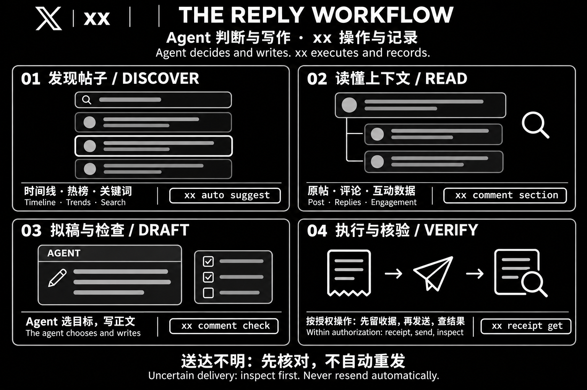

<div align="right">
  <span>[<b>English</b>]</span>
  <span>[<a href="./README.md">简体中文</a>]</span>
</div>

<div align="center">


# xx

**Let your AI agent use X.**

A local command-line tool that connects an agent, the X page, and a receipt for
every write.


[Quick start](#quick-start) · [What it does](#what-it-does) · [For agents](#for-agents) · [Development](#development)

</div>

## What this is

Hand `xx` to an agent that can run shell commands and it can read your
timeline, the Explore board, a keyword search or one conversation — and reply,
post, like, follow or delete.

**The agent does the understanding and the judgement; `xx` provides the
operation and the evidence.** It bundles no model and schedules nothing. It uses
your existing agent and your own Chrome.

The difference from similar tools is where judgement lives. There is no command
that picks a post and posts to it. If the tool chose, "why this post" would have
no answer; if it wrote, the words would not be yours. Reading and writing are
always two steps.

## Quick start

You need **Node.js 22.19+, Chrome, and an agent that can run shell commands**.

The skill lives in `skills/xx/`, in the layout Agent Skills expects, so
`npx skills add <repo> --skill xx` installs it directly.

### 1. Install

```bash
git clone <repo> && cd xx
pnpm install --ignore-scripts
pnpm build
node dist/cli.js --version
```

`xx` drives Chrome over the DevTools protocol; it does not bundle a browser.

### 2. Sign in

```bash
xx auth login
```

Sign in yourself in the window that opens. **The tool never types a password.**
The session lives in `~/.xx/chrome`, so it survives restarts.

Signing in with Google is refused — the page says *"This browser or app may not
be secure"*. That is the debugging port being detected, not an account problem.
Use:

```bash
xx auth login --manual
```

It closes the automation browser, opens the same profile **without** the
debugging port, waits until you close the window, and then reads the session
back.

### 3. Install the skill

Hand this to an agent that can run shell commands:

```text
Install the xx skill:
npx skills add <repo> --skill xx

Then read the xx skill, follow it to install the CLI,
walk me through signing in, and verify it works. Keep existing config.
```

Or copy it by hand:

```bash
cp -r skills/xx ~/.claude/skills/xx
```

### 4. Start

Send this to your agent:

> Use xx to find some posts about AI agents, pick one worth replying to, and
> show me the draft before sending. Do not send.

## What it does

| Capability | Entry point |
| --- | --- |
| Find posts worth answering (ranked, sections measured) | `xx auto suggest` |
| Read the timeline, the board, a keyword search | `xx feed read` · `xx trend read` · `xx search hot` |
| Go from a board row to the posts under it | `xx trend posts --index <n>` |
| Read one conversation | `xx comment list` · `xx post get` |
| Measure a section, check a draft against it | `xx comment section` · `xx comment check` |
| Reply, reply to a reply, publish a post | `xx comment post` · `xx comment reply` · `xx post create` |
| Like, bookmark, repost, follow | `xx post like` · `xx post bookmark` · `xx post repost` · `xx user follow` |
| Delete your own posts, singly or in a batch | `xx comment delete` · `xx comment delete-many` |
| Read notifications, bookmarks and likes | `xx notice read` · `xx saved bookmarks` · `xx saved likes` |
| Inspect a receipt or the local history | `xx receipt get` · `xx history list` |

`xx schema` lists every command, flag and effect.

## One reply, end to end



Workflow illustration: the agent decides and writes; xx executes within
authorization and keeps a record.

```bash
xx auto suggest --goal reply --limit 20
```

It gathers candidates from the timeline, the Trending board used as search
terms, and an optional keyword search; ranks them by how much attention each
reply still gets; then opens the first eight conversations and measures each
section. Every candidate comes back with `section`, `signals` (the numbers the
ranking used), `why` (why it is where it is) and `angles` (what is already in the
post).

```bash
xx comment check --status <id> --draft "…"
```

The verdict on the draft — `has-a-point` / `flat` / `generic-praise` — plus
`sameness`: whether this draft is converging on the same shape as what you
already wrote.

```bash
xx comment post --status <id> --text "…" --request-id reply-<id>-01
```

**`--request-id` is required, and every new send needs a new one.** A write without one is refused.

## Operations and evidence

- **A receipt is written before the press.** Replaying a confirmed request id
  returns the original receipt; `delivery_uncertain` is checked, never
  automatically resent.
- **Identity is the stable numeric id.** Handles and display names are
  renameable.
- **Every read is a window.** All reads report `scope: "loaded_dom"` and
  `complete: false`. An empty `items` means nothing loaded, not that nothing is
  there.
- **Judgement stays with the caller.** No automatic target selection, no
  generated reply text, no randomised or "human-like" spacing.
- **Sign-in and data stay on this machine.** `~/.xx` holds the session and the
  operation log; it does not belong in a repository or a share. Automation can
  trigger verification, rate limits or account penalties; verification is for a
  human, and the project offers no way around it.

X's automation rules prohibit bulk or indiscriminate replying, liking and
following. There are no commands for that here, and hand-written loops are not a
workaround. Automated accounts should say so in their profile, naming the
operator — that is X's developer guideline, not a suggestion.

## For agents

[skills/xx/SKILL.md](skills/xx/SKILL.md) teaches an agent to use the tool; scenario
detail lives in [skills/xx/references/](skills/xx/references/):

| File | Covers |
| --- | --- |
| `setup.md` | Install, sign-in, proxy, stuck |
| `finding.md` | Finding posts, choosing one, reading engagement |
| `writing.md` | Measuring a section, drafting, self-check, `delivery_uncertain` |
| `account.md` | New posts, follow, likes, deletes, notifications, saved |
| `platform-facts.md` | What was learned from the real page |

The usual order:

```bash
xx auth status                 # who is signed in
xx auto suggest --goal reply   # what is worth answering
xx comment section --status …  # what this section looks like
xx comment check --status … --draft "…"
xx comment post --status … --text "…" --request-id …
```

`xx schema` gives the commands, flags and effect types. One operation at a
time — a second command waits for the first to release the lease rather than
driving the same tab alongside it.

Success writes `{ok:true,data}` to stdout; failure writes `{ok:false,error}` to
stderr and exits non-zero. Writes take a unique `--request-id`; `--dry-run`
validates the input and plans without starting Chrome, typing or sending. The
full contract is in [docs/contracts.md](docs/contracts.md).

## Not included

- **Direct messages.** X gates them behind a four-digit passcode screen only the
  account owner knows, and the tool does not type credentials.
- Lists, Spaces, bookmark folders.
- Opening the post a notification is about — notification rows carry no post id.
- Automatic target selection followed by a send, generated text, humanised
  pacing.

## Development

Node.js 22.19+, pnpm and Chrome.

```bash
pnpm install --ignore-scripts
pnpm build
pnpm check           # Biome + TypeScript
pnpm test            # pure logic
pnpm test:browser    # isolated Chrome, fixture page, no credentials
```

The browser tests use no account credentials; passing them is not the same as
passing against the real page. X changes its markup; a changed control is
reported as `selector_changed` rather than retried blindly.

Working rules are in [AGENTS.md](AGENTS.md), architecture in
[docs/architecture.md](docs/architecture.md), type conventions in
[docs/typescript.md](docs/typescript.md), and the public contract in
[docs/contracts.md](docs/contracts.md).

## License

[MIT](LICENSE)
