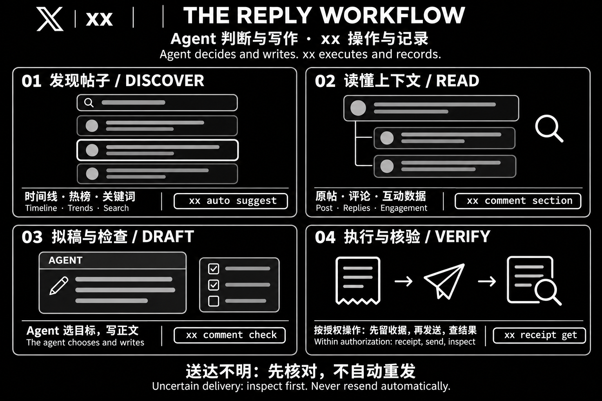

<div align="right">
  <span>[<a href="./README.en.md">English</a>]</span>
  <span>[<b>简体中文</b>]</span>
</div>

<div align="center">


# x-cli

**让你的 AI Agent 用 X（Twitter）。**

本地命令行工具，命令叫 `xx`。连接 Agent、X 页面和每一次写入的收据。


[快速开始](#快速开始) · [功能一览](#功能一览) · [给-agent-接入](#给-agent-接入) · [开发](#开发)

</div>

## 这是什么

项目叫 **x-cli**，命令叫 **`xx`**。把 `xx` 交给能执行 shell 的 AI Agent，就能读时间线、看热榜、搜关键词、读一条推下面的对话，并回复、发帖、点赞、关注、删帖。

**Agent 负责理解和判断，`xx` 提供操作和证据。** 项目不内建模型，也不运行定时任务；它用你已有的 Agent 和本机 Chrome。

和同类工具最大的不同是**判断留在调用方**。工具不会自己挑一条帖然后发出去——如果它挑了，「为什么选这条」就没有答案；如果它写了，那也不是你的话。所以读和写永远是两个动作。

## 快速开始

准备好 **Node.js 22.19+、Chrome，以及一个能执行 shell 的 Agent**。

x-cli 的 skill 在仓库的 `skills/xx/`，按 Agent Skills 的目录约定摆放，所以 `npx skills add https://github.com/9Ashwin/x-cli --skill xx` 能直接装。

### 1. 安装

```bash
git clone https://github.com/9Ashwin/x-cli && cd x-cli
pnpm install --ignore-scripts
pnpm build
node dist/cli.js --version
```

`xx` 通过 DevTools 协议驱动 Chrome，不打包浏览器。

### 2. 登录

```bash
xx auth login
```

它关掉自动化浏览器，用同一个 profile 开一个**不带调试端口**的窗口，你在里面自己登录。**登录成功那一刻它会自己发现**——profile 里一出现 `auth_token` / `ct0` 就关掉窗口、切回自动化浏览器、把登录态读回来，不需要你去关那个窗口。**工具从不输入密码**，登录态存在 `~/.xx/chrome`，一次登录长期有效。

**默认就走这条**，因为另一条会失败：Google 拒绝在带调试端口的浏览器里登录，页面写「此浏览器或应用可能不安全」。只有不用 Google 账号时才考虑 `--manual false`，那是直接在自动化浏览器里登录的短路径。

### 3. 装 skill

推荐交给 Agent 装。把下面整段复制给能执行 shell 的 Agent：

```text
请帮我安装 xx 技能：
npx skills add https://github.com/9Ashwin/x-cli --skill xx

安装后读取 xx skill，按技能指引检查并安装 CLI，
带我完成登录，并验证是否可用。已有配置请保留。
```

也可以手动复制：

```bash
cp -r skills/xx ~/.claude/skills/xx
```

### 4. 开始用

把这句话发给你的 Agent：

> 用 xx 找几条关于 AI agent 的帖子，挑一条值得回的，写好先给我看，别发。

## 功能一览

| 能力 | 常用入口 |
| --- | --- |
| 找值得回的帖子（排序 + 量区） | `xx auto suggest` |
| 读时间线、热榜、关键词搜索 | `xx feed read` · `xx trend read` · `xx search hot` |
| 从热榜走到它下面的帖子 | `xx trend posts --index <n>` |
| 读一条推下面的对话 | `xx comment list` · `xx post get` |
| 量这个区、检查自己的草稿 | `xx comment section` · `xx comment check` |
| 回复、回复某条回复、发新帖 | `xx comment post` · `xx comment reply` · `xx post create` |
| 点赞、收藏、转发、关注 | `xx post like` · `xx post bookmark` · `xx post repost` · `xx user follow` |
| 删自己的帖子（含批量） | `xx comment delete` · `xx comment delete-many` |
| 读通知、读收藏和喜欢 | `xx notice read` · `xx saved bookmarks` · `xx saved likes` |
| 查收据、查本地历史 | `xx receipt get` · `xx history list` |

完整命令、参数和副作用类型见 `xx schema`。

## 一条回复的完整流程



图为流程示意。Agent 负责判断与写作；xx 按授权操作并保留记录。

```bash
xx auto suggest --goal reply --limit 20
```

它从时间线 / 热榜词 / 关键词收集候选，按「每条回复还能分到多少注意力」排序，并打开前 8 条各自的会话把区量出来。每条带 `section`、`signals`（排序用的数）、`why`（为什么排在这）、`angles`（帖子里已有的切入点）。

```bash
xx comment check --status <id> --draft "…"
```

拿到草稿的判定：`has-a-point` / `flat` / `generic-praise`，以及 `sameness`（跟你以前发过的比，是不是在变成同一个模子）。

```bash
xx comment post --status <id> --text "…" --request-id reply-<id>-01
```

**`--request-id` 必须给，每次新的发送用新的 id。** 不给会被拒绝。

## 操作与证据边界

- **写之前先留收据。** 已确认的 request ID 重放时返回原收据；遇到 `delivery_uncertain` 先核对，**不自动重发**。
- **用稳定 ID 定位。** 帖子、账号以 CLI 返回的数字 ID 为准；昵称和 handle 都会改。
- **读到的是窗口。** 所有读取都标 `scope: "loaded_dom"`、`complete: false`。`items` 为空只说明没加载到，不说明没有。
- **判断不归工具。** 没有自动选帖发送的命令，没有生成正文，没有拟人节奏或随机间隔。
- **登录和数据留在本机。** `~/.xx` 含登录态和操作历史，不应提交或共享。自动化可能触发验证、限流或账号处罚；验证需要真人完成，项目不提供绕过手段。

X 的自动化规则禁止批量、无差别地回复、点赞和关注。工具没有这类命令，也不该手写循环绕过。用这个账号做自动化时，账号简介里应说明这一点和运营者——这是 X 开发者指南的要求。

## 给 Agent 接入

[skills/xx/SKILL.md](skills/xx/SKILL.md) 教 Agent 使用工具，场景细节在 [skills/xx/references/](skills/xx/references/)：

| 文件 | 讲什么 |
| --- | --- |
| `setup.md` | 安装、登录、代理、卡住了怎么办 |
| `finding.md` | 找帖子、挑值得回的、读互动数 |
| `writing.md` | 量一个区、写回复、自测、`delivery_uncertain` |
| `account.md` | 发新帖、关注、点赞、删帖、通知、收藏 |
| `platform-facts.md` | X 页面上摸到的事实 |

日常调用顺序：

```bash
xx auth status                 # 现在登录的是谁
xx auto suggest --goal reply   # 有什么值得回
xx comment section --status …  # 这个区长什么样
xx comment check --status … --draft "…"
xx comment post --status … --text "…" --request-id …
```

`xx schema` 提供命令、参数和副作用类型。一次只运行一个操作——两个命令会让第二个等第一个放锁，而不是同时驱动同一个标签页。

成功输出 `{ok:true,data}` 到 stdout；失败输出 `{ok:false,error}` 到 stderr，并返回非零退出码。写入使用唯一的 `--request-id`；`--dry-run` 只验证参数和计划，不连接 Chrome、不填表、不发送。完整契约见 [docs/contracts.md](docs/contracts.md)。

## 没有的

- **私信** —— X 的私信在四位数字密码屏后面，那个密码只有账号主人知道，工具不输入凭据，所以不通
- Lists、Space、书签分组
- 从通知跳到具体帖子（通知行上没有帖子 id）
- 自动选帖后直接发送、生成正文、拟人节奏

## 开发

需要 Node.js 22.19+、pnpm 和本机 Chrome。

```bash
pnpm install --ignore-scripts
pnpm build
pnpm check           # Biome + TypeScript
pnpm test            # 纯逻辑测试
pnpm test:browser    # 临时 Chrome profile + fixture 页面，不用凭据
```

浏览器测试不使用账号凭据，通过测试不等于通过真实 X 页面验证。X 会改页面结构；改变了的控件报 `selector_changed`，不会盲目重试。

开发规则见 [AGENTS.md](AGENTS.md)，架构见 [docs/architecture.md](docs/architecture.md)，类型约定见 [docs/typescript.md](docs/typescript.md)，公开契约见 [docs/contracts.md](docs/contracts.md)。

## 许可

[MIT](LICENSE)
